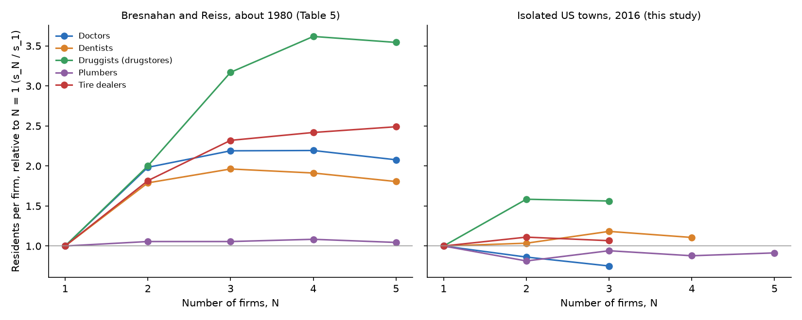
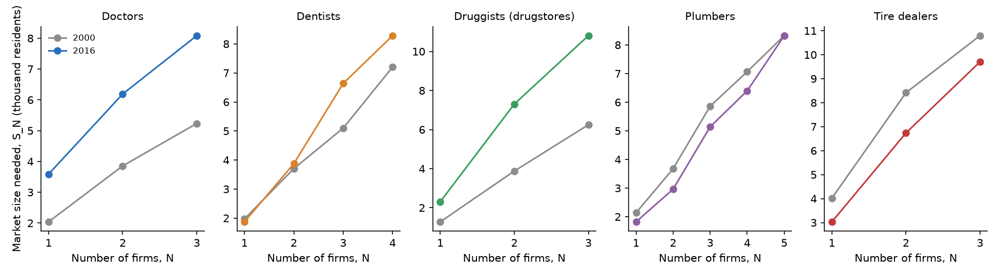

# How Big a Town Needs to Be

### In 1991, Timothy Bresnahan and Peter Reiss counted the doctors, dentists, druggists, plumbers and tire dealers in 202 isolated towns, mostly western county seats, to measure how much each new seller toughens competition. I counted them again in 445 towns.

---

Lamar, Colorado sits on U.S. Highway 50 near the Kansas line, a farm and ranching town of 7,551 people in 2016.
In 2000 the Census Bureau counted three drugstores in the ZIP code named for Lamar. In 2016 it counted none.
Miles City, Montana, a cattle town of 8,573, had one. Havre, on the Hi-Line near the Canadian border, had two for
9,757 residents. Sidney, Nebraska had 6,890 people and not a single physician's office registered in its two
ZIP codes, down from three in 2000.

Places like these are where the economics of a small market can be watched directly. A resident of Miles City who
wants another drugstore cannot just try the next town over, because the next town of any size is at least twenty
miles away. If the town grew, at some point a second drugstore would open, and then a third. How many people it
takes to support each one says something about how hard the shops compete once they share the town, even if nobody
ever sees a price or a cost. That was the insight of a paper Timothy Bresnahan and Peter Reiss published in 1991,
and the subject of this repository.

---

## Entry thresholds, and the ratio that measures competition

Write $`S_N`$ for the market size, in residents, at which a town can support $`N`$ firms in an industry. That is
the entry threshold. Dividing by the number of firms gives the residents each firm needs, $`s_N`$, and the
statistic Bresnahan and Reiss built their paper on is how that per-firm number changes as firms are added.

```math
s_N \equiv \frac{S_N}{N}, \qquad \text{threshold ratio} = \frac{s_{N+1}}{s_N}
```

If the second doctor in a town competes exactly as the first one did, the two of them need twice the population
one needed, the per-firm number stays put, and the ratio is 1. If the arrival of the second doctor pushes prices
down, each doctor earns less from each patient, so each needs more patients to cover the rent and the equipment,
and the ratio rises above 1. In their data, a town needed 880 residents to support one doctor and 3,490 to
support two.

```math
s_1 = 880, \qquad s_2 = \frac{3{,}490}{2} = 1{,}745, \qquad \frac{s_2}{s_1} = \frac{1{,}745}{880} = 1.98
```

The second doctor needed almost twice as many patients per doctor as the first, which they read as a large drop in
what each patient was worth to each doctor once there were two. In the 2016 data for drugstores, the same
arithmetic gives

```math
s_1 = 2{,}306, \qquad s_2 = \frac{7{,}309}{2} = 3{,}654, \qquad \frac{s_2}{s_1} = 1.58
```

When fixed costs are the same for every firm, the ratio is simply how much variable profit per customer falls when
the next firm opens.

| What the second firm does to profit per customer | Ratio $`s_2/s_1`$ |
|---|---|
| Leaves it unchanged | 1.0 |
| Cuts it by a third | 1.5 |
| Cuts it in half | 2.0 |

A ratio that falls back to 1 by the third or fourth firm means the town has become as competitive as it is going
to get.

---

## Bresnahan and Reiss's question

Timothy Bresnahan joined the Stanford economics department in 1979 after graduate training at Princeton. He later
spent 1999 and 2000 as chief economist of the Justice Department's Antitrust Division and chaired Stanford's
economics department from 2004 to 2008. Peter Reiss took his doctorate at Yale in 1982 and spent his career at
Stanford, where he is now the MBA Class of 1963 Professor of Economics, Emeritus, at the Graduate School of
Business. Their article, "Entry and Competition in Concentrated Markets," appeared in the *Journal of Political
Economy* in October 1991, building on earlier work in which they had estimated the first two thresholds.

The problem they set out to solve was old. Economists wanted to know how many sellers a market needs before it
behaves competitively, and the theories disagreed by a wide margin. Contestable-market theory said the threat of
entry alone could discipline a monopolist. Barrier-to-entry theory said only actual rivals counted. Testing either
required margins, and margins are almost never observed. Bresnahan and Reiss went around the problem. They found
towns or small cities at least 20 miles from the nearest town of 1,000 people and at least 100 miles from any city
of 100,000, mostly county seats in the western states, so that every seller a resident might use was inside the
town. Then they counted firms from telephone books and trade lists and asked how the count rose with population.

The argument rests on one zero-profit condition. Assume each of $`N`$ identical firms serves $`S/N`$ customers,
each of whom buys $`d_N`$ units at price $`P_N`$ with average variable cost $`AVC_N`$, and that a firm enters
whenever it covers its fixed cost $`F_N`$. Then the last firm just breaks even at $`S_N`$, and

```math
\begin{aligned}
\Pi_N &= \frac{S}{N}\,(P_N - AVC_N)\,d_N - F_N = 0 \quad \text{at } S = S_N \\
s_N &= \frac{S_N}{N} = \frac{F_N}{(P_N - AVC_N)\,d_N} \\
\frac{s_{N+1}}{s_N} &= \frac{F_{N+1}}{F_N}\cdot
\frac{(P_N - AVC_N)\,d_N}{(P_{N+1} - AVC_{N+1})\,d_{N+1}}
\end{aligned}
```

With equal fixed costs the first fraction is 1, and the ratio is the fall in variable profit per customer that
the next entrant causes. If conduct does not change, the ratio is exactly 1.

Their answer surprised them. In Table 5, a monopoly tire dealer or druggist needed about 500 people, a doctor or
dentist 700 to 900, and a plumber 1,430. The ratio $`s_2/s_1`$ was 1.98 for doctors, 1.78 for dentists, 1.99 for
druggists and 1.81 for tire dealers, and by the fourth and fifth firms every industry's ratio was between 0.94 and
1.14. Plumbers were the exception, near 1 throughout. Almost all of the change in conduct came with the second
and third firm. They checked the result against tire prices they collected by telephone in the winter of 1990.
The median quote for their test tire was $53.90 in monopoly towns, $49.80 in towns with five dealers and
$43.20 in the southern San Francisco Bay Area.

The strongest objection is one they raised themselves, and Jean Abraham, Martin Gaynor and William Vogt made it
precise in 2007. A threshold ratio mixes two things, the fall in margins and any rise in fixed costs for later
entrants. A second dentist who pays more to set up, because the good office space is taken, raises the ratio
exactly as tougher competition would. Abraham, Gaynor and Vogt used hospital output data to pull the two apart,
and for hospitals they still found that the second and third entrants did most of the work. Bresnahan and Reiss
argued that dentists, doctors and druggists in their towns had similar training and equipment,
so cost differences were unlikely to explain much. The question still matters because it is the one antitrust
agencies face every time two of four sellers in a small market want to merge, and because in the smallest towns
the real choice is often between one seller and none.

---

## How I tested it

I applied the paper's two distance rules to every incorporated town in the 48 contiguous states, using Census
coordinates for each town and Census populations for every place, including unincorporated ones. Of 19,334 towns,
923 are at least 20 miles from any other place of 1,000 people, and 592 of those are also at least 100 miles from
any city of 100,000. After matching each town to the ZIP codes whose post office carries its name, keeping towns
of at least 120 residents (the smallest in the paper), and requiring a ZIP code in both 2000 and 2016, 445 towns in
27 states remain. North Dakota, Montana, South Dakota and Nebraska supply 202 of them, and other western and Plains
states most of the rest, much as the western states supplied the paper's sample.

The paper's firm counts came from American Business Lists, a commercial directory. I used the Census Bureau's ZIP
Code Business Patterns, which counts establishments with paid employees by ZIP code and industry. The five
industries map to offices of physicians, offices of dentists, pharmacies and drug stores, plumbing and heating
contractors, and tire dealers. The main year is 2016, because from 2017 onward the Census omits any ZIP code with
only one or two establishments in an industry, and one or two is what most of these towns have when they have
any. Market size is the town's own population plus the rest of the population in its ZIP codes, which stands in
for the paper's population within ten miles of town. County per capita income from the Bureau of Economic
Analysis shifts every industry's profits, as in the paper. County births per resident shift the three health
industries; the paper used births for doctors and dentists, and I added drugstores. I left out the paper's
growth, commuting, elderly-share, climate, housing and farmland variables.

The estimating model is the paper's ordered probit. For town $`i`$, the $`N`$th firm's profit is market size
times variable profit per resident, minus fixed cost, plus a shock $`\varepsilon_i`$ that is standard normal and
shared by all firms in the town.

```math
\begin{aligned}
\Pi_{N,i} &= S_i\,V_{N,i} - F_N + \varepsilon_i \\
S_i &= \text{TPOP}_i + \lambda\,\text{OPOP}_i \\
V_{N,i} &= \alpha_1 + X_i\beta - \textstyle\sum_{n=2}^{N} \alpha_n,
\qquad F_N = \gamma_1 + \textstyle\sum_{n=2}^{N} \gamma_n \\
\Pr(N_i = N) &= \Phi(\bar{\Pi}_{N,i}) - \Phi(\bar{\Pi}_{N+1,i}),
\qquad \alpha_n,\ \gamma_n \ge 0
\end{aligned}
```

Here TPOP is town population and OPOP the rest of the ZIP code's population, both in thousands, $`X_i`$ holds the
county shifters measured from their sample means, $`\bar{\Pi}`$ is profit without the shock, and $`\Phi`$ is the
standard normal distribution. The thresholds are $`S_N = F_N / V_N`$ at the sample means. The paper required at
least ten towns in each size class and dropped industries that fell short. I keep every industry and instead
lower its top class until each class has ten towns in both years, which sets the top class at five or more for
plumbers, four or more for dentists, and three or more for doctors, drugstores and tire dealers. Confidence
intervals are the 2.5th and 97.5th percentiles of 200 bootstrap resamples of towns, with the model re-estimated
on each resample; each town is one observation, so there is nothing further to cluster. The paper's
likelihood-ratio tests check whether the per-firm thresholds are equal, with
the null hypothesis $`H_0\colon s_m = s_{m+1} = \dots = s_K`$ imposed by tying each later fixed cost to the
threshold at $`m`$.

The extension reruns the same model on the same 445 towns in 2000, with the 2000 business counts and populations,
to see whether the thresholds have moved.

---

## A small town now needs far more people to keep its first shop

| Industry | Residents needed for one firm, paper (about 1980) | 2016 | 2016 as a multiple |
|---|---|---|---|
| Doctors | 880 | 3,590 | 4.1 |
| Dentists | 710 | 1,871 | 2.6 |
| Druggists (drugstores) | 530 | 2,306 | 4.4 |
| Plumbers | 1,430 | 1,821 | 1.3 |
| Tire dealers | 490 | 3,032 | 6.2 |

The comparison across thirty-odd years is the loosest in this study, because the paper counted firms from a
directory and I count Census establishments with employees, the market definitions differ, and so do the towns.
Part of the gap is surely the source, since the Census misses sole proprietors and pharmacy counters inside
larger stores. The comparison between 2000 and 2016 further down, on the same towns with the same source, is the
cleaner one. In 2016 the typical isolated town without a drugstore had 335 residents and the typical town with
exactly one had 1,296, while 255 of the 445 towns had none.

---

## Only the drugstore still behaves the way the paper found

With their bootstrap intervals, the per-firm ratios for 2016 are

```math
\begin{aligned}
\text{Drugstores:}&\quad \hat{s}_2/\hat{s}_1 = 1.58\ [1.23,\ 2.08], \quad \hat{s}_3/\hat{s}_2 = 0.99\ [0.92,\ 1.32] \\
\text{Dentists:}&\quad \hat{s}_2/\hat{s}_1 = 1.04\ [0.89,\ 1.20], \quad \hat{s}_3/\hat{s}_2 = 1.14\ [0.97,\ 1.29] \\
\text{Tire dealers:}&\quad \hat{s}_2/\hat{s}_1 = 1.11\ [0.88,\ 1.41], \quad \hat{s}_3/\hat{s}_2 = 0.96\ [0.82,\ 1.50] \\
\text{Doctors:}&\quad \hat{s}_2/\hat{s}_1 = 0.86\ [0.79,\ 1.00], \quad \hat{s}_3/\hat{s}_2 = 0.87\ [0.82,\ 0.97] \\
\text{Plumbers:}&\quad \hat{s}_2/\hat{s}_1 = 0.81\ [0.74,\ 0.92], \quad \hat{s}_3/\hat{s}_2 = 1.16\ [0.99,\ 1.31]
\end{aligned}
```

with $`N = 445`$ towns in every model. Drugstores reproduce the paper's shape almost exactly. The second store
needs 1.58 times as many residents per store as the first, and the third needs no more per store than the
second, so the change in conduct is over by the third firm. The likelihood-ratio test rejects equal per-firm
thresholds for drugstores with $`\chi^2 = 23.5`$ on 2 degrees of freedom ($`p < 0.001`$).

| Industry | Paper $`s_2/s_1`$ | 2016 $`s_2/s_1`$ | Test of equal per-firm thresholds, 2016 |
|---|---|---|---|
| Doctors | 1.98 | 0.86 | rejected, p = 0.007, ratios below 1 |
| Dentists | 1.78 | 1.04 | not rejected, p = 0.11 |
| Druggists (drugstores) | 1.99 | 1.58 | rejected, p < 0.001 |
| Plumbers | 1.06 | 0.81 | rejected, p = 0.008, ratios below 1 |
| Tire dealers | 1.81 | 1.11 | not rejected, p = 0.61 |

For the other four industries the jump from one firm to two has disappeared. Dentists and tire dealers have ratios
close to 1 that the test cannot tell apart from 1. Doctors and plumbers have ratios below 1, meaning a second firm
needs fewer residents per firm than the first. In the derivation above that can only happen if the second firm's
fixed cost is lower or if variable profit per customer rises when it opens, and the paper's assumptions of
identical firms selling one homogeneous product rule out both. So it points to something the model leaves out.
Later entrants may have lower fixed costs, customers may buy more when there is a second office, or larger towns
may draw customers from beyond their own ZIP codes.



I checked the last explanation the way the paper did, by tightening the distance rule. Requiring 30 miles to
the nearest town of 1,000 instead of 20 leaves 176 towns. In a model with three size classes for every industry, the
drugstore ratio rises to 2.03, and the others stay near or below 1, with doctors at 0.97, dentists at 0.99, tire
dealers at 0.90 and plumbers at 0.86. These are point estimates on a smaller sample, but if leakage to other towns
were flattening the ratios, more isolation should have pushed them up.

The data lean toward a plain reading. In 2016, the second dentist or tire dealer in an isolated town does not
seem to lower what the first one earns per customer. One reason may be that their prices are no longer set in the
town. Dental and medical fees are often set by insurers and public programs, and many tires are sold at national
chain prices, so a local rival may change little. The two economists' framework cannot separate that from a rise in
the second entrant's costs, which is the Abraham, Gaynor and Vogt point, but the drugstore result shows the method
can still find the old pattern where it exists.

---

## Since 2000 the bar has risen for doctors and drugstores

| Industry | Firms | Residents needed, 2000 | 2016 | Change | 95% interval of change |
|---|---|---|---|---|---|
| Doctors | 1 | 2,040 | 3,590 | +76% | +574 to +2,939 |
| Doctors | 2 | 3,855 | 6,189 | +61% | +798 to +4,848 |
| Drugstores | 1 | 1,278 | 2,306 | +80% | +522 to +2,090 |
| Drugstores | 2 | 3,877 | 7,309 | +89% | +1,885 to +5,905 |
| Dentists | 1 | 1,970 | 1,871 | −5% | −495 to +316 |
| Dentists | 3 | 5,099 | 6,639 | +30% | +429 to +2,505 |
| Plumbers | 1 | 2,137 | 1,821 | −15% | −699 to +163 |
| Tire dealers | 1 | 4,018 | 3,032 | −25% | −2,136 to +29 |

For the same towns, the population needed to keep a first drugstore rose from 1,278 to 2,306, and for a first
physician's office from 2,040 to 3,590. In formal terms, with intervals from the paired bootstrap,

```math
\begin{aligned}
\Delta \hat{S}_1^{\text{drug}} &= +1{,}028 \text{ residents}\ [522,\ 2{,}090], \quad 100\% \text{ of draws} > 0 \\
\Delta \hat{S}_1^{\text{doctor}} &= +1{,}550 \text{ residents}\ [574,\ 2{,}939], \quad 99.5\% \text{ of draws} > 0
\end{aligned}
```

The first two dentist thresholds did not move, though the third rose by 30%, with an interval above zero. Plumbers
and tire dealers needed somewhat fewer residents in 2016, but their intervals include no change. The count of
towns with no drugstore went from 215 to 255, and with no physician's office from 268 to 303.

| Town | Population 2016 | Drugstores 2000 → 2016 | Physician's offices 2000 → 2016 |
|---|---|---|---|
| Lamar, Colorado | 7,551 | 3 → 0 | 5 → 1 |
| Ely, Nevada | 4,048 | 5 → 1 | 1 → 1 |
| Algona, Iowa | 5,501 | 3 → 0 | 1 → 1 |
| Sidney, Nebraska | 6,890 | 2 → 1 | 3 → 0 |
| Dillon, Montana | 4,281 | 1 → 1 | 9 → 1 |
| Miles City, Montana | 8,573 | 2 → 1 | 11 → 7 |

These counts need care. A pharmacy counter inside a Walmart Supercenter or a grocery store is part of that store's
establishment, and a doctor employed by the local hospital is counted under the hospital. So these numbers do not
say that Lamar has no pharmacist or that Sidney has no doctor. What the data show is that the freestanding
drugstore and the freestanding physician's office now need a much larger town to survive, which is consistent with a
shift of both businesses toward chains, supercenters and hospital systems, a shift these counts cannot show
directly.



---

## Why it matters

For people who live in these towns, the higher thresholds mean the shop on Main Street is more fragile than it
was. A town whose market lies between 1,278 and 2,306 residents was above the point where the model says a
drugstore breaks even in 2000, and is below it in 2016. Residents of a town that loses its drugstore fill
prescriptions at a supercenter counter, by mail or in another town.

For workers, the change in these counts is probably a change in who owns the business. The freestanding
drugstore and doctor's office are the part that thinned out in these counts, so the pharmacists and doctors who
remain in such towns are likely to work for a chain, a supercenter or a hospital, outlets these counts file
elsewhere.

For smaller firms, the ratio results say that a second independent dentist or tire shop in a small town does not
face the price war the paper's numbers implied for 1980. What decides whether it survives is the size of the town
and its fixed costs, and the population needed to cover them has risen for doctors and drugstores.

For antitrust policy, the paper's lesson was that competition in a small market is mostly settled by the third
firm. In 2016 that still holds for drugstores. For doctors, dentists and tire dealers, local seller counts carry
less information than they used to, because the second seller no longer changes conduct much. A merger review
that counts local rivals in such markets should also ask who sets the prices.

---

## Limits of this study

The Census counts establishments with employees, so a plumber working alone, a pharmacy inside a supercenter and a
clinic owned by a hospital are missing or filed elsewhere, and all of that changed between 2000 and 2016. A ZIP
code is a rough market, and some post-office names did not match a town. The latest year with exact counts is
2016, and the 2022 file can only confirm the upper end (the number of towns with three or more dentists went from
40 to 37). I use only two of the paper's profit shifters. The hinterland population for 2000 and 2016 is scaled
from 2018 to 2022 figures by county growth. The comparison with the paper is across different sources and towns.
Most of all, a threshold ratio cannot separate falling margins from rising entry costs, and without prices this
study cannot say which one moved.

---

## Further reading

- [TECHNICAL.md](TECHNICAL.md) for the data, the model, every test statistic and how to reproduce the results.
- [results/FINDINGS.md](results/FINDINGS.md) for a plain-English summary and every table the scripts produce.
- [METHODS_REVIEW.md](METHODS_REVIEW.md) for a review of the original paper's methods and statistical reporting.
- Timothy F. Bresnahan and Peter C. Reiss, "Entry and Competition in Concentrated Markets," *Journal of Political
  Economy* 99(5), 1991, pp. 977–1009.
- Jean M. Abraham, Martin S. Gaynor and William B. Vogt, "Entry and Competition in Local Hospital Markets," *Journal
  of Industrial Economics* 55(2), 2007, pp. 265–288.
- US Census Bureau, ZIP Code Business Patterns, 2000, 2016 and 2022
  (www2.census.gov/programs-surveys/cbp/datasets/).
- US Census Bureau, population estimates for places and counties, and the 2023 Gazetteer place file
  (www2.census.gov/programs-surveys/popest/ and www2.census.gov/geo/docs/maps-data/data/gazetteer/).
- US Census Bureau, American Community Survey 2018–2022 five-year table B01003, for place and ZIP code population.
- Bureau of Economic Analysis, county personal income table CAINC1 (apps.bea.gov/regional/zip/CAINC1.zip).

*Brendyn Beasley*
