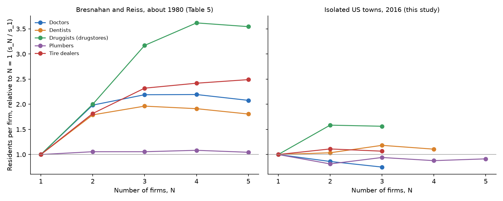
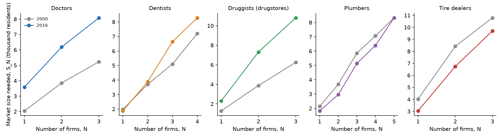

# Bresnahan and Reiss (1991) in 2016: findings

## In plain English

Bresnahan and Reiss counted sellers in 202 isolated towns, mostly western county seats, and found that a town
needed roughly twice as many residents per firm to support a second doctor, dentist, druggist or tire dealer as it
needed for the first, and about the same per firm after the third. They read that as competition arriving fast
and then leveling off. This study reruns their model on 445 isolated towns with 2016 Census business counts, and
on the same towns in 2000.

- **Drugstores still follow the paper.** A second freestanding drugstore needs 1.58 times as many residents per
  store as the first, and the third no more than the second. In 2016 Havre, Montana (9,757 people) had two
  drugstores and Miles City, Montana (8,573) had one.
- **For doctors, dentists, plumbers and tire dealers, the jump at the second firm is gone.** Their per-firm
  ratios are near or below 1, so a second dentist or tire shop does not appear to change how the first one
  competes.
- **The first shop needs a much bigger town than it used to.** A freestanding drugstore needed a market of about
  1,278 residents in 2000 and 2,306 in 2016; a physician's office 2,040 and 3,590. Lamar, Colorado (7,551) went
  from three drugstores to none, and Sidney, Nebraska (6,890) from three physician's offices to none. Pharmacy
  counters inside supercenters and doctors on hospital payrolls are counted elsewhere, so these are the
  freestanding outlets that thinned out.
- **Plumbers and tire dealers moved the other way, but not clearly.** Their first-firm thresholds fell by 15% and
  25% between 2000 and 2016, with intervals that include no change.

A friendlier tour is in the [README](../README.md) and the method is in [TECHNICAL.md](../TECHNICAL.md).

**Key to the labels.** *N* = number of establishments in the town's ZIP codes. *K* = top class (K or more
firms). *S_N* = market size (thousand residents) at which N firms break even; *S_lo*, *S_hi* = 95% bootstrap
interval. *s_N* = S_N / N, residents per firm. *ratio* = s_N / s_(N-1). *paper_* = Bresnahan and Reiss (1991),
Table 5. *S_over_paper* = 2016 or 2000 threshold divided by the paper's. *lambda_hinterland* = weight on ZIP
residents outside town; *a* terms = falls in variable profit per resident; *g* terms = increases in fixed cost.
*share_boot_higher* = share of bootstrap draws with a higher 2016 threshold. *tpop*, *opop* = town and
hinterland population; *n_zips* = ZIP codes matched to the town. Druggists means NAICS 446110 pharmacies and
drug stores (freestanding drugstores); plumbers means plumbing, heating and air-conditioning contractors. The
isolation check fits three size classes for every industry, so its 20-mile row differs from the main estimates
for dentists and plumbers.

## Entry thresholds and per-firm ratios, 2016 and 2000, with the paper's Table 5

`results/entry_thresholds.csv`

| year | industry | K | N | S_N | S_lo | S_hi | s_N | paper_S_N | S_over_paper | paper_ratio | ratio | ratio_lo | ratio_hi |
|---|---|---|---|---|---|---|---|---|---|---|---|---|---|
| 2016 | doctors | 3 | 1 | 3.59 | 2.794 | 4.848 | 3.59 | 0.88 | 4.08 |  |  |  |  |
| 2016 | doctors | 3 | 2 | 6.189 | 4.733 | 8.498 | 3.095 | 3.49 | 1.773 | 1.98 | 0.862 | 0.792 | 1.002 |
| 2016 | doctors | 3 | 3 | 8.084 | 6.306 | 11.029 | 2.695 | 5.78 | 1.399 | 1.1 | 0.871 | 0.819 | 0.974 |
| 2000 | doctors | 3 | 1 | 2.04 | 1.565 | 2.463 | 2.04 | 0.88 | 2.318 |  |  |  |  |
| 2000 | doctors | 3 | 2 | 3.855 | 3.16 | 4.816 | 1.927 | 3.49 | 1.105 | 1.98 | 0.945 | 0.851 | 1.13 |
| 2000 | doctors | 3 | 3 | 5.234 | 4.231 | 6.43 | 1.745 | 5.78 | 0.906 | 1.1 | 0.905 | 0.834 | 0.982 |
| 2016 | dentists | 4 | 1 | 1.871 | 1.489 | 2.217 | 1.871 | 0.71 | 2.635 |  |  |  |  |
| 2016 | dentists | 4 | 2 | 3.874 | 3.201 | 4.66 | 1.937 | 2.54 | 1.525 | 1.78 | 1.035 | 0.892 | 1.198 |
| 2016 | dentists | 4 | 3 | 6.639 | 5.457 | 7.577 | 2.213 | 4.18 | 1.588 | 0.79 | 1.143 | 0.97 | 1.291 |
| 2016 | dentists | 4 | 4 | 8.285 | 6.935 | 10.129 | 2.071 | 5.43 | 1.526 | 0.97 | 0.936 | 0.876 | 1.097 |
| 2000 | dentists | 4 | 1 | 1.97 | 1.498 | 2.37 | 1.97 | 0.71 | 2.775 |  |  |  |  |
| 2000 | dentists | 4 | 2 | 3.704 | 2.998 | 4.567 | 1.852 | 2.54 | 1.458 | 1.78 | 0.94 | 0.843 | 1.098 |
| 2000 | dentists | 4 | 3 | 5.099 | 4.21 | 5.995 | 1.7 | 4.18 | 1.22 | 0.79 | 0.918 | 0.827 | 1.023 |
| 2000 | dentists | 4 | 4 | 7.204 | 6.003 | 8.86 | 1.801 | 5.43 | 1.327 | 0.97 | 1.06 | 0.96 | 1.218 |
| 2016 | druggists | 3 | 1 | 2.306 | 1.608 | 3.306 | 2.306 | 0.53 | 4.352 |  |  |  |  |
| 2016 | druggists | 3 | 2 | 7.309 | 5.48 | 9.831 | 3.654 | 2.12 | 3.447 | 1.99 | 1.584 | 1.225 | 2.077 |
| 2016 | druggists | 3 | 3 | 10.81 | 8.415 | 15.485 | 3.603 | 5.04 | 2.145 | 1.58 | 0.986 | 0.922 | 1.324 |
| 2000 | druggists | 3 | 1 | 1.278 | 0.935 | 1.573 | 1.278 | 0.53 | 2.412 |  |  |  |  |
| 2000 | druggists | 3 | 2 | 3.877 | 3.159 | 4.564 | 1.939 | 2.12 | 1.829 | 1.99 | 1.517 | 1.317 | 1.927 |
| 2000 | druggists | 3 | 3 | 6.249 | 4.909 | 7.519 | 2.083 | 5.04 | 1.24 | 1.58 | 1.074 | 0.936 | 1.343 |
| 2016 | plumbers | 5 | 1 | 1.821 | 1.431 | 2.226 | 1.821 | 1.43 | 1.273 |  |  |  |  |
| 2016 | plumbers | 5 | 2 | 2.963 | 2.346 | 3.568 | 1.481 | 3.02 | 0.981 | 1.06 | 0.813 | 0.738 | 0.921 |
| 2016 | plumbers | 5 | 3 | 5.141 | 3.836 | 6.18 | 1.714 | 4.53 | 1.135 | 1 | 1.157 | 0.989 | 1.305 |
| 2016 | plumbers | 5 | 4 | 6.398 | 4.862 | 7.752 | 1.599 | 6.2 | 1.032 | 1.02 | 0.933 | 0.871 | 1.06 |
| 2016 | plumbers | 5 | 5 | 8.322 | 6.467 | 10.25 | 1.664 | 7.47 | 1.114 | 0.96 | 1.041 | 0.944 | 1.189 |
| 2000 | plumbers | 5 | 1 | 2.137 | 1.661 | 2.588 | 2.137 | 1.43 | 1.494 |  |  |  |  |
| 2000 | plumbers | 5 | 2 | 3.677 | 2.818 | 4.623 | 1.839 | 3.02 | 1.218 | 1.06 | 0.861 | 0.775 | 0.983 |
| 2000 | plumbers | 5 | 3 | 5.861 | 4.419 | 7.071 | 1.954 | 4.53 | 1.294 | 1 | 1.063 | 0.922 | 1.195 |
| 2000 | plumbers | 5 | 4 | 7.067 | 5.442 | 8.584 | 1.767 | 6.2 | 1.14 | 1.02 | 0.904 | 0.851 | 1.021 |
| 2000 | plumbers | 5 | 5 | 8.326 | 6.295 | 10.06 | 1.665 | 7.47 | 1.115 | 0.96 | 0.943 | 0.884 | 1.043 |
| 2016 | tire_dealers | 3 | 1 | 3.032 | 2.403 | 4.384 | 3.032 | 0.49 | 6.189 |  |  |  |  |
| 2016 | tire_dealers | 3 | 2 | 6.738 | 5.406 | 9.432 | 3.369 | 1.78 | 3.785 | 1.81 | 1.111 | 0.884 | 1.405 |
| 2016 | tire_dealers | 3 | 3 | 9.704 | 7.333 | 19.033 | 3.235 | 3.41 | 2.846 | 1.28 | 0.96 | 0.816 | 1.502 |
| 2000 | tire_dealers | 3 | 1 | 4.018 | 3.067 | 5.624 | 4.018 | 0.49 | 8.201 |  |  |  |  |
| 2000 | tire_dealers | 3 | 2 | 8.414 | 6.288 | 12.426 | 4.207 | 1.78 | 4.727 | 1.81 | 1.047 | 0.831 | 1.379 |
| 2000 | tire_dealers | 3 | 3 | 10.795 | 7.844 | 18.029 | 3.598 | 3.41 | 3.166 | 1.28 | 0.855 | 0.761 | 1.163 |

## Extension: change in thresholds, 2000 to 2016 (paired bootstrap)

`results/threshold_change.csv`

| industry | N | S_2000 | S_2016 | change | pct_change | change_lo | change_hi | share_boot_higher |
|---|---|---|---|---|---|---|---|---|
| doctors | 1 | 2.04 | 3.59 | 1.55 | 75.982 | 0.574 | 2.939 | 0.995 |
| doctors | 2 | 3.855 | 6.189 | 2.334 | 60.552 | 0.798 | 4.848 | 0.99 |
| doctors | 3 | 5.234 | 8.084 | 2.851 | 54.464 | 0.65 | 5.827 | 0.995 |
| dentists | 1 | 1.97 | 1.871 | -0.099 | -5.039 | -0.495 | 0.316 | 0.405 |
| dentists | 2 | 3.704 | 3.874 | 0.17 | 4.591 | -0.741 | 0.836 | 0.65 |
| dentists | 3 | 5.099 | 6.639 | 1.54 | 30.195 | 0.429 | 2.505 | 1 |
| dentists | 4 | 7.204 | 8.285 | 1.081 | 15.006 | -0.61 | 2.461 | 0.89 |
| druggists | 1 | 1.278 | 2.306 | 1.028 | 80.439 | 0.522 | 2.09 | 1 |
| druggists | 2 | 3.877 | 7.309 | 3.431 | 88.503 | 1.885 | 5.905 | 1 |
| druggists | 3 | 6.249 | 10.81 | 4.561 | 72.989 | 2.162 | 9.262 | 1 |
| plumbers | 1 | 2.137 | 1.821 | -0.316 | -14.77 | -0.699 | 0.163 | 0.09 |
| plumbers | 2 | 3.677 | 2.963 | -0.715 | -19.435 | -1.59 | 0.068 | 0.045 |
| plumbers | 3 | 5.861 | 5.141 | -0.72 | -12.285 | -2.198 | 0.327 | 0.13 |
| plumbers | 4 | 7.067 | 6.398 | -0.669 | -9.463 | -2.483 | 0.665 | 0.14 |
| plumbers | 5 | 8.326 | 8.322 | -0.003 | -0.038 | -2.042 | 1.707 | 0.505 |
| tire_dealers | 1 | 4.018 | 3.032 | -0.986 | -24.536 | -2.136 | 0.029 | 0.035 |
| tire_dealers | 2 | 8.414 | 6.738 | -1.676 | -19.922 | -5.148 | 0.613 | 0.12 |
| tire_dealers | 3 | 10.795 | 9.704 | -1.091 | -10.104 | -6.344 | 5.559 | 0.36 |

## Likelihood-ratio tests of equal per-firm thresholds

`results/lr_tests.csv`

| year | industry | hypothesis | lr_stat | df | p_value |
|---|---|---|---|---|---|
| 2016 | doctors | s2 = s3 | 5.471 | 1 | 0.019 |
| 2016 | doctors | s1 = s2 = s3 | 9.928 | 2 | 0.007 |
| 2000 | doctors | s2 = s3 | 4.341 | 1 | 0.037 |
| 2000 | doctors | s1 = s2 = s3 | 5.144 | 2 | 0.076 |
| 2016 | dentists | s3 = s4 | 0.899 | 1 | 0.343 |
| 2016 | dentists | s2 = s3 = s4 | 4.098 | 2 | 0.129 |
| 2016 | dentists | s1 = s2 = s3 = s4 | 6.001 | 3 | 0.112 |
| 2000 | dentists | s3 = s4 | 1.154 | 1 | 0.283 |
| 2000 | dentists | s2 = s3 = s4 | 2.962 | 2 | 0.227 |
| 2000 | dentists | s1 = s2 = s3 = s4 | 5.236 | 3 | 0.155 |
| 2016 | druggists | s2 = s3 | 0.047 | 1 | 0.829 |
| 2016 | druggists | s1 = s2 = s3 | 23.462 | 2 | 0 |
| 2000 | druggists | s2 = s3 | 1.087 | 1 | 0.297 |
| 2000 | druggists | s1 = s2 = s3 | 40.62 | 2 | 0 |
| 2016 | plumbers | s4 = s5 | 0.528 | 1 | 0.468 |
| 2016 | plumbers | s3 = s4 = s5 | 2.331 | 2 | 0.312 |
| 2016 | plumbers | s2 = s3 = s4 = s5 | 7.728 | 3 | 0.052 |
| 2016 | plumbers | s1 = s2 = s3 = s4 = s5 | 13.796 | 4 | 0.008 |
| 2000 | plumbers | s4 = s5 | 1.944 | 1 | 0.163 |
| 2000 | plumbers | s3 = s4 = s5 | 6.113 | 2 | 0.047 |
| 2000 | plumbers | s2 = s3 = s4 = s5 | 6.28 | 3 | 0.099 |
| 2000 | plumbers | s1 = s2 = s3 = s4 = s5 | 12.269 | 4 | 0.015 |
| 2016 | tire_dealers | s2 = s3 | 0.105 | 1 | 0.746 |
| 2016 | tire_dealers | s1 = s2 = s3 | 0.982 | 2 | 0.612 |
| 2000 | tire_dealers | s2 = s3 | 1.788 | 1 | 0.181 |
| 2000 | tire_dealers | s1 = s2 = s3 | 1.809 | 2 | 0.405 |

## Isolation check: 2016 thresholds as the distance rule tightens

`results/isolation_check.csv`

| min_miles_to_1k_town | towns | industry | S_1 | S_2 | S_3 | s2_s1 | s3_s2 |
|---|---|---|---|---|---|---|---|
| 20 | 445 | doctors | 3.59 | 6.189 | 8.084 | 0.862 | 0.871 |
| 20 | 445 | dentists | 1.818 | 3.785 | 6.449 | 1.041 | 1.136 |
| 20 | 445 | druggists | 2.307 | 7.309 | 10.81 | 1.584 | 0.986 |
| 20 | 445 | plumbers | 1.687 | 2.704 | 4.523 | 0.801 | 1.115 |
| 20 | 445 | tire_dealers | 3.032 | 6.738 | 9.704 | 1.111 | 0.96 |
| 25 | 285 | doctors | 3.525 | 6.434 | 8.539 | 0.912 | 0.885 |
| 25 | 285 | dentists | 1.909 | 3.904 | 6.043 | 1.022 | 1.032 |
| 25 | 285 | druggists | 1.616 | 6.398 | 11.433 | 1.979 | 1.191 |
| 25 | 285 | plumbers | 1.568 | 2.632 | 4.346 | 0.839 | 1.101 |
| 25 | 285 | tire_dealers | 3.377 | 6.317 | 8.606 | 0.935 | 0.908 |
| 30 | 176 | doctors | 3.994 | 7.773 | 10.292 | 0.973 | 0.883 |
| 30 | 176 | dentists | 2.21 | 4.361 | 6.952 | 0.987 | 1.063 |
| 30 | 176 | druggists | 1.709 | 6.956 | 13.879 | 2.035 | 1.33 |
| 30 | 176 | plumbers | 1.872 | 3.203 | 5.44 | 0.855 | 1.132 |
| 30 | 176 | tire_dealers | 4.248 | 7.655 | 11.628 | 0.901 | 1.013 |

## Towns by number of establishments, with median town population (Table 2 analog)

`results/market_counts.csv`

| year | industry | n_firms | towns | median_town_pop |
|---|---|---|---|---|
| 2016 | doctors | 0 | 303 | 534 |
| 2016 | doctors | 1 | 82 | 1271 |
| 2016 | doctors | 2 | 29 | 2338 |
| 2016 | doctors | 3 | 9 | 3510 |
| 2016 | doctors | 4 | 7 | 8389 |
| 2016 | doctors | 5 | 15 | 6430 |
| 2016 | dentists | 0 | 264 | 378 |
| 2016 | dentists | 1 | 96 | 1257 |
| 2016 | dentists | 2 | 45 | 2799 |
| 2016 | dentists | 3 | 18 | 3214 |
| 2016 | dentists | 4 | 10 | 4987 |
| 2016 | dentists | 5 | 12 | 8062 |
| 2016 | druggists | 0 | 255 | 335 |
| 2016 | druggists | 1 | 143 | 1296 |
| 2016 | druggists | 2 | 35 | 2457 |
| 2016 | druggists | 3 | 6 | 2184 |
| 2016 | druggists | 4 | 4 | 8312 |
| 2016 | druggists | 5 | 2 | 18822 |
| 2016 | plumbers | 0 | 234 | 337 |
| 2016 | plumbers | 1 | 79 | 925 |
| 2016 | plumbers | 2 | 64 | 1384 |
| 2016 | plumbers | 3 | 23 | 2457 |
| 2016 | plumbers | 4 | 20 | 3558 |
| 2016 | plumbers | 5 | 25 | 6006 |
| 2016 | tire_dealers | 0 | 337 | 554 |
| 2016 | tire_dealers | 1 | 75 | 2034 |
| 2016 | tire_dealers | 2 | 21 | 2684 |
| 2016 | tire_dealers | 3 | 9 | 5685 |
| 2016 | tire_dealers | 4 | 1 | 3377 |
| 2016 | tire_dealers | 5 | 2 | 24666 |
| 2000 | doctors | 0 | 268 | 473 |
| 2000 | doctors | 1 | 100 | 1262 |
| 2000 | doctors | 2 | 37 | 1742 |
| 2000 | doctors | 3 | 11 | 3933 |
| 2000 | doctors | 4 | 6 | 3430 |
| 2000 | doctors | 5 | 23 | 5961 |
| 2000 | dentists | 0 | 251 | 377 |
| 2000 | dentists | 1 | 101 | 1282 |
| 2000 | dentists | 2 | 37 | 2715 |
| 2000 | dentists | 3 | 30 | 2966 |
| 2000 | dentists | 4 | 9 | 5363 |
| 2000 | dentists | 5 | 17 | 8524 |
| 2000 | druggists | 0 | 215 | 320 |
| 2000 | druggists | 1 | 149 | 1298 |
| 2000 | druggists | 2 | 52 | 2304 |
| 2000 | druggists | 3 | 17 | 3612 |
| 2000 | druggists | 4 | 6 | 3594 |
| 2000 | druggists | 5 | 6 | 8678 |
| 2000 | plumbers | 0 | 244 | 390 |
| 2000 | plumbers | 1 | 87 | 1078 |
| 2000 | plumbers | 2 | 53 | 1948 |
| 2000 | plumbers | 3 | 20 | 2448 |
| 2000 | plumbers | 4 | 14 | 2881 |
| 2000 | plumbers | 5 | 27 | 5654 |
| 2000 | tire_dealers | 0 | 350 | 608 |
| 2000 | tire_dealers | 1 | 69 | 1838 |
| 2000 | tire_dealers | 2 | 15 | 3298 |
| 2000 | tire_dealers | 3 | 7 | 5654 |
| 2000 | tire_dealers | 4 | 4 | 7828 |
| 2000 | tire_dealers | 5 | 0 |  |

## 2022 check: towns with three or more establishments

`results/check_2022_three_plus.csv`

| industry | towns_3plus_2016 | towns_3plus_2022 | both | median_pop_3plus_2016 | median_pop_3plus_2022 |
|---|---|---|---|---|---|
| doctors | 31 | 28 | 22 | 6006 | 5460 |
| dentists | 40 | 37 | 29 | 4380 | 4389 |
| druggists | 12 | 12 | 7 | 6058 | 5766 |
| plumbers | 68 | 68 | 53 | 3560 | 3396 |
| tire_dealers | 12 | 11 | 8 | 5848 | 5601 |

## Sample statistics, estimation sample (Table 3 analog)

`results/sample_stats.csv`

| measure | mean | std | min | median | max |
|---|---|---|---|---|---|
| Town population, 2016 | 1522 | 2410 | 120 | 784 | 26580 |
| Hinterland population, 2016 | 964 | 1510 | 0 | 466 | 18694 |
| Town population, 2000 | 1516 | 2002 | 96 | 826 | 16019 |
| County per capita income, 2016 ($000) | 43.092 | 8.497 | 25.103 | 41.875 | 80.706 |
| County births per resident, 2016 | 0.012 | 0.003 | 0.005 | 0.012 | 0.028 |
| Miles to nearest place of 1,000+ | 30.527 | 9.698 | 20.109 | 27.766 | 93.606 |
| Miles to nearest city of 100,000+ | 164 | 49.8 | 100 | 153 | 327 |
| Doctors, 2016 | 0.721 | 1.75 | 0 | 0 | 14 |
| Dentists, 2016 | 0.834 | 1.591 | 0 | 0 | 14 |
| Druggists (drugstores), 2016 | 0.589 | 0.9 | 0 | 0 | 8 |
| Plumbers, 2016 | 1.209 | 2.059 | 0 | 0 | 20 |
| Tire dealers, 2016 | 0.362 | 0.798 | 0 | 0 | 7 |
| Doctors, 2000 | 0.964 | 2.224 | 0 | 0 | 25 |
| Dentists, 2000 | 0.93 | 1.602 | 0 | 0 | 14 |
| Druggists (drugstores), 2000 | 0.818 | 1.099 | 0 | 1 | 9 |
| Plumbers, 2000 | 1.126 | 1.905 | 0 | 0 | 13 |
| Tire dealers, 2000 | 0.306 | 0.695 | 0 | 0 | 4 |

## Sample construction

`results/sample_funnel.csv`

| step | towns |
|---|---|
| Incorporated places, contiguous states | 19334 |
| ... at least 20 miles from any other place of 1,000+ | 923 |
| ... and at least 100 miles from any city of 100,000+ | 592 |
| ... with 2022 population of at most 50,000 | 591 |
| ... with a name unique among the isolated towns of its state | 591 |
| ... with a ZIP code named for the town in both the 2000 and 2016 ZBP | 544 |
| ... with town populations and county covariates in every year | 542 |
| ... with at least 120 residents in 2016 (estimation sample) | 445 |

## Estimation sample by state

`results/towns_by_state.csv`

| state | towns |
|---|---|
| North Dakota | 68 |
| Montana | 52 |
| South Dakota | 43 |
| Nebraska | 39 |
| Kansas | 37 |
| Wyoming | 35 |
| Minnesota | 31 |
| Utah | 20 |
| Colorado | 20 |
| Oregon | 18 |
| New Mexico | 14 |
| Idaho | 12 |
| Texas | 12 |
| Michigan | 9 |
| Oklahoma | 9 |
| Wisconsin | 5 |
| West Virginia | 4 |
| California | 3 |
| Arizona | 3 |
| Missouri | 2 |
| Nevada | 2 |
| Arkansas | 2 |
| Iowa | 1 |
| Pennsylvania | 1 |
| Vermont | 1 |
| Virginia | 1 |
| Washington | 1 |

## Towns named in the README

`results/featured_towns.csv`

| town | st | tpop00 | tpop16 | n_zips | miles_to_1k_town | doctors_2000 | doctors_2016 | dentists_2000 | dentists_2016 | druggists_2000 | druggists_2016 | plumbers_2000 | plumbers_2016 | tire_dealers_2000 | tire_dealers_2016 |
|---|---|---|---|---|---|---|---|---|---|---|---|---|---|---|---|
| Lamar city | CO | 8878 | 7551 | 1 | 33 | 5 | 1 | 5 | 5 | 3 | 0 | 8 | 5 | 1 | 3 |
| Miles City city | MT | 8524 | 8573 | 1 | 41 | 11 | 7 | 5 | 5 | 2 | 1 | 4 | 5 | 3 | 2 |
| Havre city | MT | 9587 | 9757 | 1 | 21 | 5 | 5 | 4 | 4 | 3 | 2 | 8 | 9 | 4 | 3 |
| Sidney city | NE | 6394 | 6890 | 2 | 36 | 3 | 0 | 5 | 3 | 2 | 1 | 4 | 5 | 1 | 3 |
| Ely city | NV | 4070 | 4048 | 2 | 94 | 1 | 1 | 3 | 3 | 5 | 1 | 3 | 2 | 1 | 1 |
| Algona city | IA | 5770 | 5501 | 1 | 22 | 1 | 1 | 5 | 2 | 3 | 0 | 4 | 5 | 2 | 2 |
| Dillon city | MT | 4290 | 4281 | 1 | 47 | 9 | 1 | 4 | 5 | 1 | 1 | 6 | 5 | 4 | 2 |

## Named towns behind the numbers

`results/named_towns.csv`

| industry | kind | town | st | tpop16 | tpop00 | opop16 | firms_2000 | firms_2016 |
|---|---|---|---|---|---|---|---|---|
| doctors | largest towns with 0 in 2016 | Sidney city | NE | 6890 | 6394 | 875 | 3 | 0 |
| doctors | largest towns with 0 in 2016 | Torrington city | WY | 6594 | 5999 | 3735 | 2 | 0 |
| doctors | largest towns with 0 in 2016 | Tucumcari city | NM | 4959 | 5962 | 1466 | 6 | 0 |
| doctors | largest towns with 1 in 2016 | Lamar city | CO | 7551 | 8878 | 1550 | 5 | 1 |
| doctors | largest towns with 1 in 2016 | Douglas city | WY | 6480 | 5316 | 3207 | 5 | 1 |
| doctors | largest towns with 1 in 2016 | International Falls city | MN | 6028 | 6705 | 3431 | 3 | 1 |
| doctors | largest towns with 2 in 2016 | Watford City city | ND | 6414 | 1439 | 2987 | 0 | 2 |
| doctors | largest towns with 2 in 2016 | Worland city | WY | 5273 | 5363 | 2276 | 7 | 2 |
| doctors | largest towns with 2 in 2016 | Goodland city | KS | 4439 | 4937 | 694 | 3 | 2 |
| doctors | biggest losses 2000-2016 | Alpena city | MI | 10104 | 11287 | 11803 | 25 | 14 |
| doctors | biggest losses 2000-2016 | Dillon city | MT | 4281 | 4290 | 3851 | 9 | 1 |
| doctors | biggest losses 2000-2016 | Williston city | ND | 26580 | 12540 | 6004 | 10 | 4 |
| doctors | biggest gains 2000-2016 | Eagle River city | WI | 1413 | 1469 | 6172 | 1 | 11 |
| doctors | biggest gains 2000-2016 | Beaver city | UT | 3039 | 2655 | 15 | 3 | 9 |
| doctors | biggest gains 2000-2016 | Chadron city | NE | 5685 | 5654 | 1430 | 1 | 7 |
| dentists | largest towns with 0 in 2016 | Presidio city | TX | 4083 | 4188 | 208 | 0 | 0 |
| dentists | largest towns with 0 in 2016 | Clayton town | NM | 2749 | 2569 | 586 | 0 | 0 |
| dentists | largest towns with 0 in 2016 | Santa Rosa city | NM | 2686 | 2807 | 849 | 0 | 0 |
| dentists | largest towns with 1 in 2016 | Worland city | WY | 5273 | 5363 | 2276 | 4 | 1 |
| dentists | largest towns with 1 in 2016 | Tucumcari city | NM | 4959 | 5962 | 1466 | 2 | 1 |
| dentists | largest towns with 1 in 2016 | Hugoton city | KS | 3870 | 3728 | 1061 | 1 | 1 |
| dentists | largest towns with 2 in 2016 | Winslow city | AZ | 9608 | 9538 | 5917 | 5 | 2 |
| dentists | largest towns with 2 in 2016 | Sidney city | MT | 6569 | 5110 | 2470 | 3 | 2 |
| dentists | largest towns with 2 in 2016 | De Queen city | AR | 6519 | 5952 | 4878 | 3 | 2 |
| dentists | biggest losses 2000-2016 | Moab city | UT | 5262 | 4833 | 4853 | 6 | 2 |
| dentists | biggest losses 2000-2016 | Worland city | WY | 5273 | 5363 | 2276 | 4 | 1 |
| dentists | biggest losses 2000-2016 | Algona city | IA | 5501 | 5770 | 1741 | 5 | 2 |
| dentists | biggest gains 2000-2016 | Bemidji city | MN | 14891 | 12125 | 18694 | 8 | 11 |
| dentists | biggest gains 2000-2016 | Williston city | ND | 26580 | 12540 | 6004 | 12 | 14 |
| dentists | biggest gains 2000-2016 | Buffalo city | WY | 4576 | 3933 | 2846 | 2 | 4 |
| druggists | largest towns with 0 in 2016 | Winslow city | AZ | 9608 | 9538 | 5917 | 0 | 0 |
| druggists | largest towns with 0 in 2016 | Lamar city | CO | 7551 | 8878 | 1550 | 3 | 0 |
| druggists | largest towns with 0 in 2016 | Gunnison city | CO | 6430 | 5483 | 3664 | 1 | 0 |
| druggists | largest towns with 1 in 2016 | Miles City city | MT | 8573 | 8524 | 3118 | 2 | 1 |
| druggists | largest towns with 1 in 2016 | Alliance city | NE | 8389 | 9057 | 1704 | 3 | 1 |
| druggists | largest towns with 1 in 2016 | Sidney city | NE | 6890 | 6394 | 875 | 2 | 1 |
| druggists | largest towns with 2 in 2016 | Havre city | MT | 9757 | 9587 | 3176 | 3 | 2 |
| druggists | largest towns with 2 in 2016 | Rawlins city | WY | 9117 | 9083 | 194 | 2 | 2 |
| druggists | largest towns with 2 in 2016 | Sidney city | MT | 6569 | 5110 | 2470 | 2 | 2 |
| druggists | biggest losses 2000-2016 | Ely city | NV | 4048 | 4070 | 3715 | 5 | 1 |
| druggists | biggest losses 2000-2016 | Algona city | IA | 5501 | 5770 | 1741 | 3 | 0 |
| druggists | biggest losses 2000-2016 | Lamar city | CO | 7551 | 8878 | 1550 | 3 | 0 |
| druggists | biggest gains 2000-2016 | Bemidji city | MN | 14891 | 12125 | 18694 | 4 | 8 |
| druggists | biggest gains 2000-2016 | Ellendale city | ND | 1246 | 1573 | 622 | 0 | 2 |
| druggists | biggest gains 2000-2016 | Beaver city | UT | 3039 | 2655 | 15 | 1 | 3 |
| plumbers | largest towns with 0 in 2016 | Presidio city | TX | 4083 | 4188 | 208 | 0 | 0 |
| plumbers | largest towns with 0 in 2016 | St. Johns city | AZ | 3486 | 3594 | 826 | 0 | 0 |
| plumbers | largest towns with 0 in 2016 | Beaver city | UT | 3039 | 2655 | 15 | 2 | 0 |
| plumbers | largest towns with 1 in 2016 | Salmon city | ID | 3052 | 3496 | 3336 | 2 | 1 |
| plumbers | largest towns with 1 in 2016 | Winner city | SD | 2858 | 3179 | 1259 | 0 | 1 |
| plumbers | largest towns with 1 in 2016 | Santa Rosa city | NM | 2686 | 2807 | 849 | 1 | 1 |
| plumbers | largest towns with 2 in 2016 | Winslow city | AZ | 9608 | 9538 | 5917 | 2 | 2 |
| plumbers | largest towns with 2 in 2016 | Childress city | TX | 6084 | 6753 | 1035 | 2 | 2 |
| plumbers | largest towns with 2 in 2016 | Tucumcari city | NM | 4959 | 5962 | 1466 | 3 | 2 |
| plumbers | biggest losses 2000-2016 | Mena city | AR | 5597 | 6068 | 7882 | 9 | 5 |
| plumbers | biggest losses 2000-2016 | Wheatland town | WY | 3592 | 3542 | 3029 | 7 | 4 |
| plumbers | biggest losses 2000-2016 | Chadron city | NE | 5685 | 5654 | 1430 | 8 | 5 |
| plumbers | biggest gains 2000-2016 | Dickinson city | ND | 22752 | 16019 | 4154 | 11 | 20 |
| plumbers | biggest gains 2000-2016 | Williston city | ND | 26580 | 12540 | 6004 | 8 | 12 |
| plumbers | biggest gains 2000-2016 | Baker City city | OR | 9732 | 9849 | 2255 | 3 | 6 |
| tire_dealers | largest towns with 0 in 2016 | Alpena city | MI | 10104 | 11287 | 11803 | 1 | 0 |
| tire_dealers | largest towns with 0 in 2016 | Alliance city | NE | 8389 | 9057 | 1704 | 0 | 0 |
| tire_dealers | largest towns with 0 in 2016 | Newport city | VT | 4321 | 5003 | 3153 | 1 | 0 |
| tire_dealers | largest towns with 1 in 2016 | Winslow city | AZ | 9608 | 9538 | 5917 | 0 | 1 |
| tire_dealers | largest towns with 1 in 2016 | Rawlins city | WY | 9117 | 9083 | 194 | 1 | 1 |
| tire_dealers | largest towns with 1 in 2016 | Torrington city | WY | 6594 | 5999 | 3735 | 2 | 1 |
| tire_dealers | largest towns with 2 in 2016 | Bemidji city | MN | 14891 | 12125 | 18694 | 2 | 2 |
| tire_dealers | largest towns with 2 in 2016 | Baker City city | OR | 9732 | 9849 | 2255 | 3 | 2 |
| tire_dealers | largest towns with 2 in 2016 | Miles City city | MT | 8573 | 8524 | 3118 | 3 | 2 |
| tire_dealers | biggest losses 2000-2016 | Hackensack city | MN | 306 | 282 | 1420 | 2 | 0 |
| tire_dealers | biggest losses 2000-2016 | Alpine city | TX | 6006 | 5961 | 2072 | 3 | 1 |
| tire_dealers | biggest losses 2000-2016 | Newcastle city | WY | 3526 | 3298 | 2144 | 2 | 0 |
| tire_dealers | biggest gains 2000-2016 | Williston city | ND | 26580 | 12540 | 6004 | 2 | 6 |
| tire_dealers | biggest gains 2000-2016 | Dickinson city | ND | 22752 | 16019 | 4154 | 4 | 7 |
| tire_dealers | biggest gains 2000-2016 | De Queen city | AR | 6519 | 5952 | 4878 | 0 | 2 |

## Ordered probit estimates (Table 4 analog)

`results/probit_estimates.csv`

| year | industry | parameter | estimate | std_error |
|---|---|---|---|---|
| 2016 | doctors | lambda_hinterland | 0.93 | 0.271 |
| 2016 | doctors | b_income | -0.003 | 0.003 |
| 2016 | doctors | b_births | -0.017 | 0.061 |
| 2016 | doctors | a1_V1 | 0.37 | 0.052 |
| 2016 | doctors | a2_V1-V2 | 0.003 | 0.043 |
| 2016 | doctors | a3_V2-V3 | 0 | 0.056 |
| 2016 | doctors | g1_F1 | 1.33 | 0.106 |
| 2016 | doctors | g2_F2-F1 | 0.945 | 0.16 |
| 2016 | doctors | g3_F3-F2 | 0.697 | 0.264 |
| 2016 | doctors | log_likelihood | -311 |  |
| 2000 | doctors | lambda_hinterland | 0.315 | 0.141 |
| 2000 | doctors | b_income | 0.001 | 0.007 |
| 2000 | doctors | b_births | -0.066 | 0.086 |
| 2000 | doctors | a1_V1 | 0.586 | 0.073 |
| 2000 | doctors | a2_V1-V2 | 0.013 | 0.07 |
| 2000 | doctors | a3_V2-V3 | 0 | 0.076 |
| 2000 | doctors | g1_F1 | 1.195 | 0.107 |
| 2000 | doctors | g2_F2-F1 | 1.014 | 0.161 |
| 2000 | doctors | g3_F3-F2 | 0.79 | 0.249 |
| 2000 | doctors | log_likelihood | -346 |  |
| 2016 | dentists | lambda_hinterland | 0.698 | 0.138 |
| 2016 | dentists | b_income | 0.005 | 0.003 |
| 2016 | dentists | b_births | -0.273 | 0.068 |
| 2016 | dentists | a1_V1 | 0.973 | 0.11 |
| 2016 | dentists | a2_V1-V2 | 0.305 | 0.109 |
| 2016 | dentists | a3_V2-V3 | 0.24 | 0.072 |
| 2016 | dentists | a4_V3-V4 | 0 | 0.067 |
| 2016 | dentists | g1_F1 | 1.82 | 0.145 |
| 2016 | dentists | g2_F2-F1 | 0.764 | 0.215 |
| 2016 | dentists | g3_F3-F2 | 0.249 | 0.241 |
| 2016 | dentists | g4_F4-F3 | 0.702 | 0.407 |
| 2016 | dentists | log_likelihood | -310 |  |
| 2000 | dentists | lambda_hinterland | 0.79 | 0.14 |
| 2000 | dentists | b_income | 0.023 | 0.006 |
| 2000 | dentists | b_births | -0.148 | 0.069 |
| 2000 | dentists | a1_V1 | 0.83 | 0.084 |
| 2000 | dentists | a2_V1-V2 | 0.05 | 0.098 |
| 2000 | dentists | a3_V2-V3 | 0.127 | 0.088 |
| 2000 | dentists | a4_V3-V4 | 0.03 | 0.105 |
| 2000 | dentists | g1_F1 | 1.636 | 0.137 |
| 2000 | dentists | g2_F2-F1 | 1.255 | 0.24 |
| 2000 | dentists | g3_F3-F2 | 0.444 | 0.313 |
| 2000 | dentists | g4_F4-F3 | 1.157 | 0.593 |
| 2000 | dentists | log_likelihood | -321 |  |
| 2016 | druggists | lambda_hinterland | 0.501 | 0.231 |
| 2016 | druggists | b_income | 0.006 | 0.003 |
| 2016 | druggists | b_births | -0.162 | 0.07 |
| 2016 | druggists | a1_V1 | 0.355 | 0.054 |
| 2016 | druggists | a2_V1-V2 | 0.086 | 0.052 |
| 2016 | druggists | a3_V2-V3 | 0 | 0.054 |
| 2016 | druggists | g1_F1 | 0.818 | 0.092 |
| 2016 | druggists | g2_F2-F1 | 1.146 | 0.151 |
| 2016 | druggists | g3_F3-F2 | 0.941 | 0.268 |
| 2016 | druggists | log_likelihood | -362 |  |
| 2000 | druggists | lambda_hinterland | 0.349 | 0.129 |
| 2000 | druggists | b_income | 0.028 | 0.007 |
| 2000 | druggists | b_births | -0.407 | 0.08 |
| 2000 | druggists | a1_V1 | 0.888 | 0.096 |
| 2000 | druggists | a2_V1-V2 | 0.324 | 0.094 |
| 2000 | druggists | a3_V2-V3 | 0.088 | 0.069 |
| 2000 | druggists | g1_F1 | 1.135 | 0.111 |
| 2000 | druggists | g2_F2-F1 | 1.052 | 0.176 |
| 2000 | druggists | g3_F3-F2 | 0.789 | 0.25 |
| 2000 | druggists | log_likelihood | -347 |  |
| 2016 | plumbers | lambda_hinterland | 0.945 | 0.181 |
| 2016 | plumbers | b_income | 0.013 | 0.002 |
| 2016 | plumbers | a1_V1 | 0.709 | 0.086 |
| 2016 | plumbers | a2_V1-V2 | 0.019 | 0.073 |
| 2016 | plumbers | a3_V2-V3 | 0.189 | 0.075 |
| 2016 | plumbers | a4_V3-V4 | 0 | 0.064 |
| 2016 | plumbers | a5_V4-V5 | 0.032 | 0.072 |
| 2016 | plumbers | g1_F1 | 1.291 | 0.121 |
| 2016 | plumbers | g2_F2-F1 | 0.751 | 0.151 |
| 2016 | plumbers | g3_F3-F2 | 0.53 | 0.2 |
| 2016 | plumbers | g4_F4-F3 | 0.629 | 0.292 |
| 2016 | plumbers | g5_F5-F4 | 0.699 | 0.464 |
| 2016 | plumbers | log_likelihood | -422 |  |
| 2000 | plumbers | lambda_hinterland | 0.984 | 0.2 |
| 2000 | plumbers | b_income | 0.025 | 0.005 |
| 2000 | plumbers | a1_V1 | 0.617 | 0.078 |
| 2000 | plumbers | a2_V1-V2 | 0.035 | 0.065 |
| 2000 | plumbers | a3_V2-V3 | 0.149 | 0.067 |
| 2000 | plumbers | a4_V3-V4 | 0.013 | 0.04 |
| 2000 | plumbers | a5_V4-V5 | 0 | 0.051 |
| 2000 | plumbers | g1_F1 | 1.318 | 0.12 |
| 2000 | plumbers | g2_F2-F1 | 0.82 | 0.157 |
| 2000 | plumbers | g3_F3-F2 | 0.399 | 0.202 |
| 2000 | plumbers | g4_F4-F3 | 0.43 | 0.204 |
| 2000 | plumbers | g5_F5-F4 | 0.528 | 0.305 |
| 2000 | plumbers | log_likelihood | -417 |  |
| 2016 | tire_dealers | lambda_hinterland | 0 | 0.139 |
| 2016 | tire_dealers | b_income | 0.007 | 0.003 |
| 2016 | tire_dealers | a1_V1 | 0.49 | 0.062 |
| 2016 | tire_dealers | a2_V1-V2 | 0.163 | 0.066 |
| 2016 | tire_dealers | a3_V2-V3 | 0.039 | 0.054 |
| 2016 | tire_dealers | g1_F1 | 1.485 | 0.107 |
| 2016 | tire_dealers | g2_F2-F1 | 0.715 | 0.169 |
| 2016 | tire_dealers | g3_F3-F2 | 0.589 | 0.248 |
| 2016 | tire_dealers | log_likelihood | -253 |  |
| 2000 | tire_dealers | lambda_hinterland | 0.193 | 0.187 |
| 2000 | tire_dealers | b_income | 0.009 | 0.007 |
| 2000 | tire_dealers | a1_V1 | 0.385 | 0.049 |
| 2000 | tire_dealers | a2_V1-V2 | 0.104 | 0.057 |
| 2000 | tire_dealers | a3_V2-V3 | 0.009 | 0.041 |
| 2000 | tire_dealers | g1_F1 | 1.548 | 0.115 |
| 2000 | tire_dealers | g2_F2-F1 | 0.817 | 0.197 |
| 2000 | tire_dealers | g3_F3-F2 | 0.568 | 0.252 |
| 2000 | tire_dealers | log_likelihood | -237 |  |

## Figures

